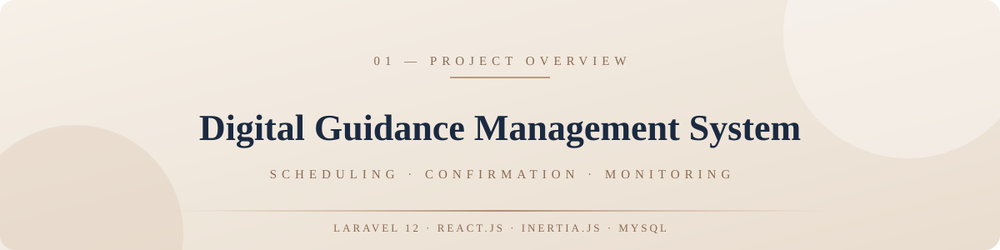
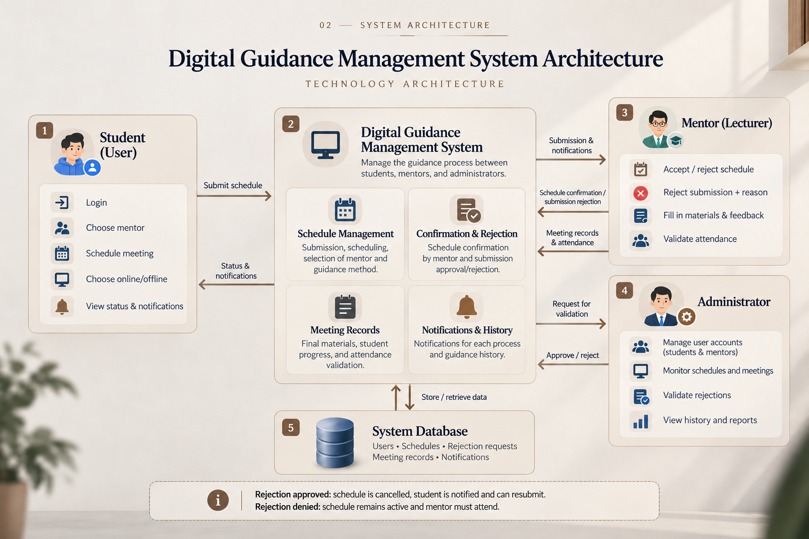
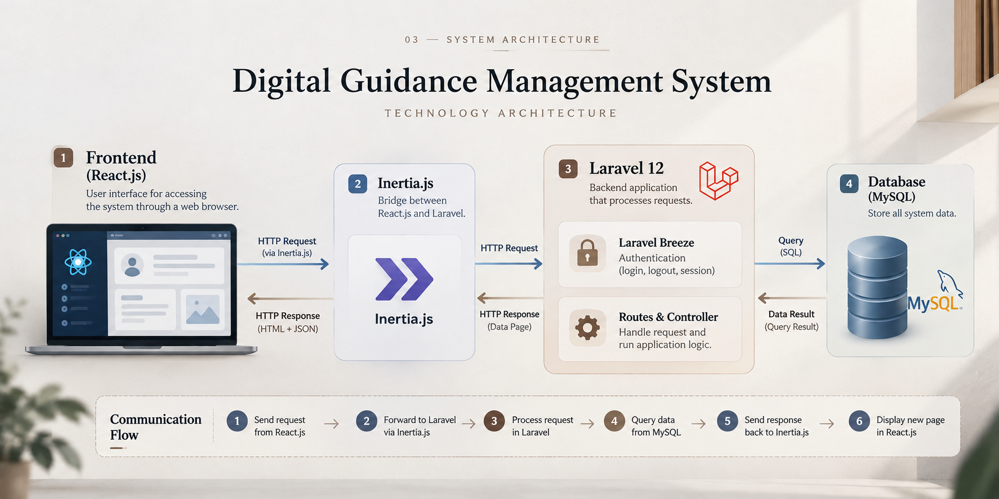

<div align="center">



<br/>


*A web application that manages the guidance process between participants, mentors, and administrators.*

*Team project built during an internship at Mediatama Web Indonesia*

</div>

---

## 01 — Overview

During my internship, our team found that the guidance process at the partner institution was not managed well: scheduling, mentor confirmation, and rejections lacked a clear and monitored workflow.

This system was built to solve that problem. It supports all three parties involved, **participants**, **mentors**, and **administrators**, from scheduling a session to recording what happened in it.

> **System scope:** the system starts *after* a participant has completed registration and administration. The administrator then creates an account for the participant and hands it over so the participant can log in. From there, the whole guidance process runs inside the system.

---

## 02 — Roles & Features

<table>
  <tr>
    <td width="33%" valign="top">
      <h3>🙋 Participant<br/><sub>(Student)</sub></h3>
      <ul>
        <li>Login</li>
        <li>Select mentor</li>
        <li>Set schedule</li>
        <li>Choose online / offline</li>
        <li>View status &amp; notifications</li>
      </ul>
    </td>
    <td width="33%" valign="top">
      <h3>🎓 Mentor<br/><sub>(Lecturer)</sub></h3>
      <ul>
        <li>Accept / reject schedule</li>
        <li>Submit rejection with a reason</li>
        <li>Record materials &amp; participant progress</li>
        <li>Validate attendance</li>
      </ul>
    </td>
    <td width="33%" valign="top">
      <h3>🛠️ Administrator</h3>
      <ul>
        <li>Manage participant &amp; mentor accounts</li>
        <li>Monitor schedules and meetings</li>
        <li>Validate rejections</li>
        <li>View history and reports</li>
      </ul>
    </td>
  </tr>
</table>

---

## 03 — Core Modules

<table>
  <tr>
    <td width="50%" valign="top">
      <h3>📅 Schedule Management</h3>
      Submission, scheduling, mentor selection, and guidance method.
    </td>
    <td width="50%" valign="top">
      <h3>✅ Confirmation &amp; Rejection</h3>
      Schedule confirmation by mentors and submission of rejection requests.
    </td>
  </tr>
  <tr>
    <td width="50%" valign="top">
      <h3>📝 Meeting Records</h3>
      Final materials, participant progress, and attendance validation.
    </td>
    <td width="50%" valign="top">
      <h3>🔔 Notifications &amp; History</h3>
      Notifications for each process and the guidance history.
    </td>
  </tr>
</table>

---

## 04 — Workflow

1. The administrator creates accounts for registered participants.
2. The **participant** logs in, selects a mentor, sets a schedule, and chooses the method (online or offline).
3. The request appears in the chosen **mentor's** account, and the mentor confirms the meeting.
4. If the mentor cannot attend, they submit a **rejection with a valid reason**.
5. The **administrator** validates the request:
   - ✅ **Rejection approved:** the schedule is cancelled, and the participant is notified and must resubmit.
   - ❌ **Rejection denied:** the schedule remains active, and the mentor must attend.
6. After a successful meeting, the mentor records the **final materials**, the **participant's progress**, and validates **attendance**.
7. The administrator monitors the whole process through history and reports.

<div align="center">
  
</div>

---

## 05 — Technology Architecture

The application is a **Single Page Application (SPA)**. React.js and Laravel communicate through Inertia.js: React renders the pages, while Laravel handles routing, authentication, and data.

| # | Layer | Technology | Role |
|:-:|---|---|---|
| 1 | Frontend | React.js | User interface for accessing the system through a web browser |
| 2 | Bridge | Inertia.js | Connects React.js and Laravel |
| 3 | Backend | Laravel 12 | Processes requests: routes, controllers, and application logic |
| 3 | Authentication | Laravel Breeze | Login, logout, and session handling |
| 3 | Access control | Role-based access | Separates what Participant, Mentor, and Administrator can do |
| 4 | Database | MySQL | Stores all system data |

<div align="center">
  
</div>

### Communication flow
1. React.js sends a request.
2. Inertia.js forwards it to Laravel.
3. Laravel processes the request.
4. Laravel queries data from MySQL.
5. Laravel sends the response back to Inertia.js.
6. React.js displays the new page.

---

## 06 — Getting Started

### Prerequisites
- PHP 8.2+ and Composer
- Node.js and npm
- MySQL

### Installation
```bash
git clone https://github.com/DoriFransDika/Sistem_management_bimbingan_digital.git
cd Sistem_management_bimbingan_digital

composer install
npm install

cp .env.example .env
php artisan key:generate
```

Edit `.env` with your own database credentials, then run:

```bash
php artisan migrate --seed
npm run dev
php artisan serve
```

> Adjust the PHP version and the `--seed` option to match this repository.

---

## 07 — Author

<div align="center">

**Dori Frans Dika**
Informatics Engineering graduate, Institut Teknologi Padang

[LinkedIn](https://linkedin.com/in/dori-frans-dika) · [GitHub](https://github.com/DoriFransDika) · [Portfolio](https://my-portfolio-alpha-nine-51.vercel.app/) · dorifransdikaa@gmail.com

</div>
